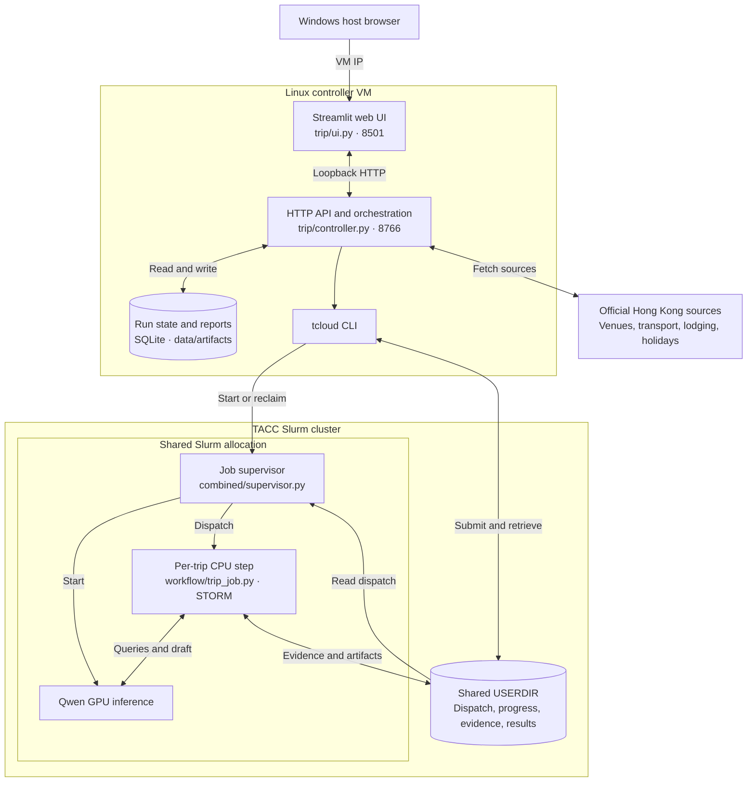
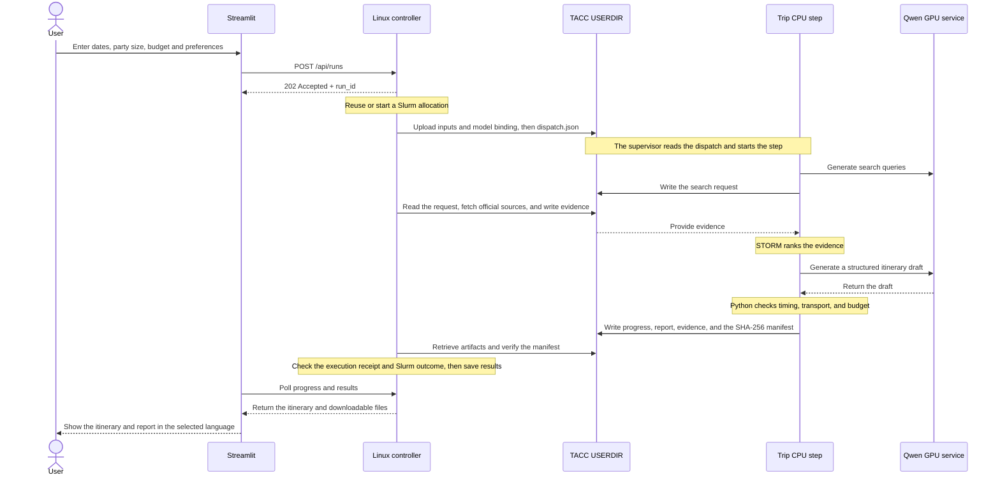

# Hong Kong Trip Planner Architecture

[简体中文](ARCHITECTURE.zh.md)

## Deployment

The Windows browser opens Streamlit on the Linux controller. The controller serves the UI and API, persists run state, and fetches source material. TACC runs Qwen and per-trip CPU steps in one Slurm allocation.

## One trip run

The API returns a run ID immediately. The CPU step asks the controller for official evidence via shared files, ranks that evidence with STORM, and uses Qwen to draft an itinerary. The controller validates the returned artifacts and Slurm outcome before publishing the completed run.

[README](README.md) · [Workflow and API details](workflow/README.md)
