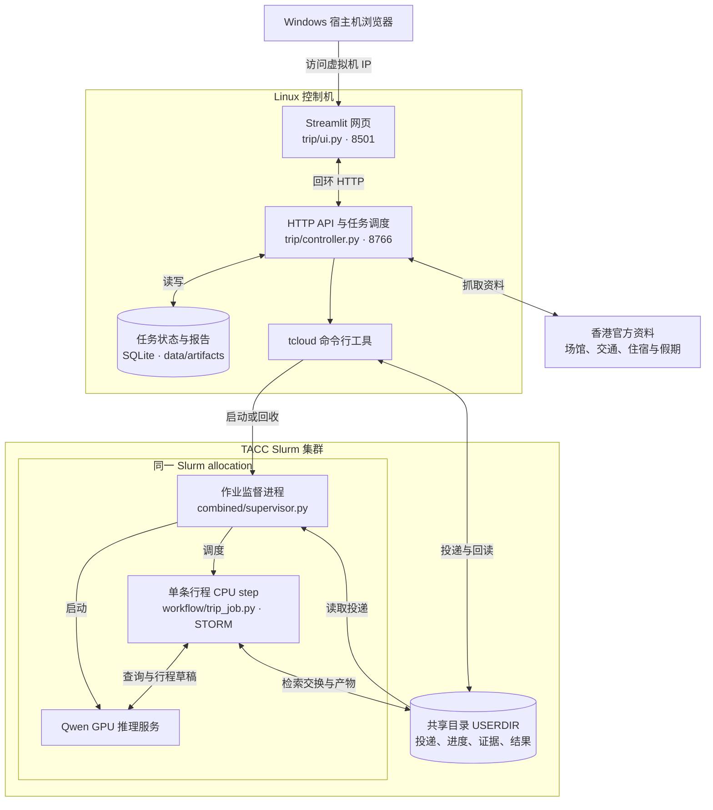
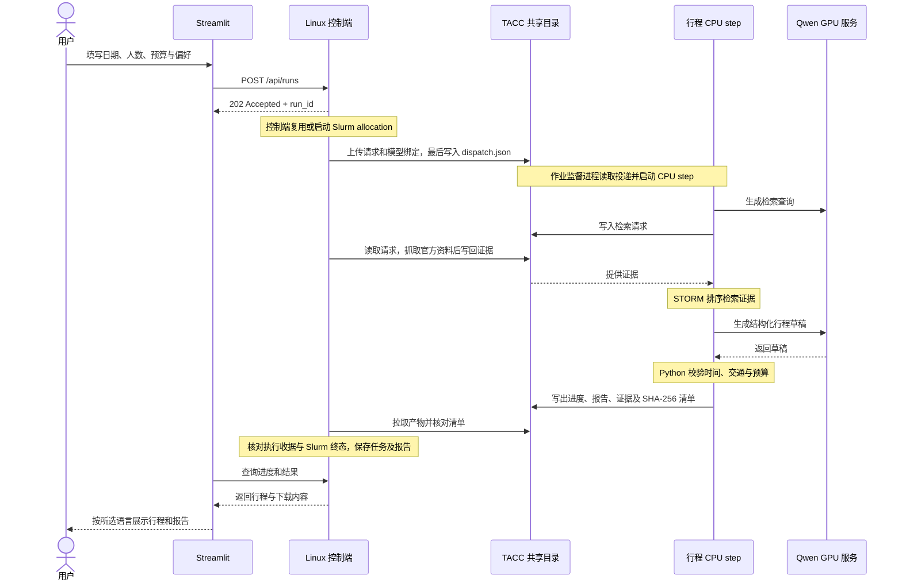

# 香港行程规划架构

[English](ARCHITECTURE.md)

## 部署架构

Windows 浏览器访问 Linux 控制机的 Streamlit 页面。控制机负责网页、API、任务持久化和资料抓取。TACC 在同一项 Slurm 资源分配中运行 Qwen 服务和各行程的 CPU step。

## 单次行程

API 受理请求后立即返回任务 ID。CPU step 通过共享目录向控制端请求官方资料，用 STORM 对证据排序，再调用 Qwen 生成行程草稿。控制端核对返回的产物和 Slurm 终态后，将任务标为完成。

[中文 README](README.zh.md) · [工作流与 API 细节](workflow/README.md)
